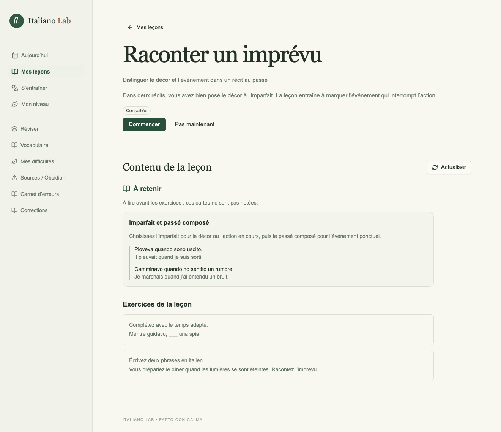
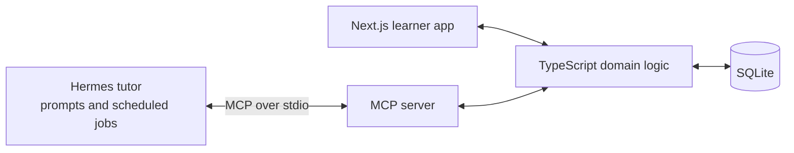

# Italiano Lab

Italiano Lab is a local Italian tutor for French-speaking learners. It turns written practice into a next step. A Hermes agent reviews open-ended answers, identifies recurring mistakes and proposes a focused lesson. The app tracks what the learner can do independently and schedules follow-up practice.



In this example, the learner used the Italian imperfect for a one-off event in two different exercises. Italiano Lab shows the reason for the recommended lesson and lets the learner decide when to start. The screenshots use synthetic learner data. [See the written feedback](docs/screenshots/written-feedback.png)

## Run locally

Use Node.js 24. With nvm, run these commands from the repository root.

```sh
nvm install
nvm use
npm ci
npm run dev -- --hostname 127.0.0.1 --port 3211
```

Open [http://127.0.0.1:3211](http://127.0.0.1:3211) and try **Les goûts · Questionnaire** under **Séances**. The sample sessions, flashcards and closed-question grading work without an API key. To enable agent feedback and scheduled jobs, connect a Hermes profile using the [MCP setup guide](docs/PROF_INTEGRATION.md).

## How it works



- The app grades closed questions with deterministic rules and queues open answers for the agent.
- The agent reads the original prompt and rubric, then submits feedback against a specific attempt. The server validates tool inputs and accepts stable request IDs for safe retries of writes.
- For a remedial lesson, the agent submits evidence from at least two independent attempts. The server checks the evidence and lesson requirements before publishing. It schedules reviews after the learner completes the initial lesson.

Explore the [MCP tools](src/server/mcp.ts), [agent correction workflow](automation/correct-prof.md) and [item history design](docs/adr/0001-identite-et-historique-des-items.md).

## Configuration and checks

- `ITALIANO_DB_PATH` defaults to `data/italiano.sqlite`. Use the same absolute path for the web app and MCP server when overriding it.
- `ITALIANO_REMINDERS_PATH` optionally points the web app to a read-only Hermes reminders JSON file.

```sh
npm test
npm run test:mcp
npm run lint
npx tsc --noEmit
npm run build -- --webpack
npx playwright install chromium
ITALIANO_TEST_PORT=3212 npm run test:browser:isolated
```

The MCP check launches the actual stdio server against a temporary database. The Playwright suite starts its own local app with separate test data. Start with the [teacher integration guide](docs/PROF_INTEGRATION.md) for agent setup or browse the [project archive](docs/archive/README.md) for earlier specs and reports.
